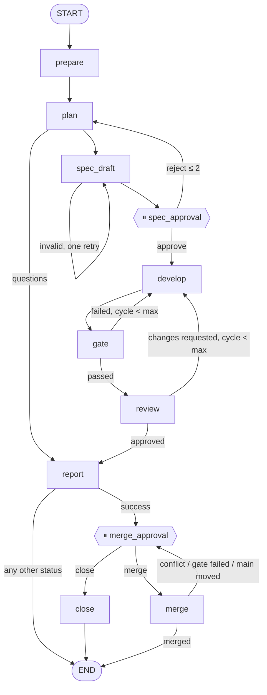

# Agentic Software Factory

Takes a development task against a target repository and drives it to a **verified** result:

1. **Planner** — explores the code read-only and returns a structured plan plus an
   **OpenSpec change** (requirements grounded in the acceptance criteria), or asks questions.
2. **Spec approval** — a human approves or rejects the spec (`--auto-approve-spec` in eval).
3. **Developer** — implements the approved spec in an isolated git worktree.
4. **Quality Gate** — typecheck and tests run by the factory (not the agent) in a Docker
   sandbox with `--network none`, plus scope and spec-immutability checks of the diff.
5. **Reviewer** — independent read-only review, by a model from **another vendor**
   (OpenCode), of the diff against the spec and the acceptance criteria.
6. **Report**, then **merge approval** — a human merges or closes; the gate re-runs on the
   merge result before `main` moves. Nothing is ever merged automatically.

> Status: Week 2 — the loop is a LangGraph.js state graph with SQLite checkpoints (resume
> after a crash), OpenSpec specs with an approval gate, a merge gate, and OpenCode as the
> independent reviewer. Week 2 results: [docs/week2-results.md](docs/week2-results.md).

## Architecture



Errors, timeouts and budget stops from any node go to `report`. The full graph with every
edge, node table and idempotency rules: [docs/graph.md](docs/graph.md); design decisions:
[docs/week2-design.md](docs/week2-design.md).

- **The graph routes, nodes execute.** `src/workflow/decide.ts` is the single routing rule
  (transitions, limits on edges, errors); `src/workflow/nodes.ts` holds thin nodes that call
  `agents/`, `git/`, `quality/`, `spec/`, `runtimes/`. The edges are tested against
  `docs/graph.md`.
- **State and checkpoints:** `data/factory.db` (better-sqlite3, migrations in `migrations/`)
  holds runs, steps, attempts, events, approvals, baselines and evals; LangGraph's
  `SqliteSaver` writes a checkpoint after every node (`thread_id = runId`). Secrets are masked
  before anything is stored.
- **Idempotent replay:** a node that changes files first resets the worktree to the last
  committed head (path-guarded to managed worktrees), so a node re-run after a crash never
  works on top of partial changes.
- `runtimes/` — `AgentRuntime` contract; `claude-code.ts` (headless `claude -p`),
  `opencode.ts` (`opencode run --format json`, read-only roles only), per-role tool policy.
- `schemas/` — Zod at every boundary: tasks, specs, config, agent answers, steps, reports,
  eval summaries. An answer that does not match its schema is a step error, never repaired.
- `spec/openspec.ts` — renders the planner's spec JSON into `openspec/changes/<taskId>/`,
  `openspec validate --strict`, `openspec archive` at merge time.
- `fixtures/taskflow/` — the target (Fastify + TypeScript), materialized as a real git repo
  under `FACTORY_WORKDIR`; eval starts from its immutable `factory-baseline` tag.
- `evals/tasks/` (visible) · `evals/hidden/` (hidden tests + eval metadata) ·
  `evals/reference/` (reference patches) — the last two are never reachable from agents.
  `evals/review/` — frozen reviewer evaluation set (15 diffs with known defects / clean).

### Statuses and limits

`needs_clarification` · `gate_failed` · `review_rejected` · `timeout` · `budget_exceeded` ·
`error` · `infra_error` (terminal; the model provider was unavailable — excluded from eval metrics) · `awaiting_spec_approval` · `awaiting_merge_approval` → `merged` |
`closed`. Every step has a timeout capped by the task deadline; each agent call gets only the
remaining budget; at most `max_fix_cycles` (≤ 2) develop→gate/review cycles; at most 2 spec
rejections and one spec repair attempt. A run reaches `awaiting_merge_approval` only if the
sandboxed checks exit 0 and the reviewer's structured verdict approves with every criterion
met. In eval, that success claim is checked by hidden tests: `verified` or `false_success`.

## How to run

```bash
npm ci
cp .env.example .env          # OPENAI_API_KEY for the OpenCode reviewer; optional paths
claude auth status            # the Claude Code CLI must be logged in
```

| Command                                                       | What it does                                                                           |
| ------------------------------------------------------------- | -------------------------------------------------------------------------------------- |
| `npm run run-task -- <taskId> [--auto-approve-spec]`          | Run one task from `main`; stops at spec approval (see `runs/<runId>/spec-approval.md`) |
| `npm run approve -- <runId> spec`                             | Approve the spec and continue to development                                           |
| `npm run reject -- <runId> spec --comment "…"`                | Send the spec back to the planner with the comment (≤ 2 times)                         |
| `npm run merge -- <runId>`                                    | Merge a successful run: `--no-ff` + spec archive, gate on the merge result, then ff    |
| `npm run close -- <runId> --comment "…"`                      | Close a successful run without merging                                                 |
| `npm run resume -- <runId>`                                   | Continue an interrupted run from its last checkpoint                                   |
| `npm run runs [-- <limit>]`                                   | List recent runs from the database                                                     |
| `npm run eval [-- [--repeat N] [--cost-cap USD] <taskId>...]` | Eval suite from `factory-baseline`, N repeats, hidden-test verification                |
| `npm run eval -- --resume <evalId> [--repeat N]`              | Continue an eval interrupted by a provider limit and/or add repeats up to N            |
| `npm run eval:review [-- --only <runtime>]`                   | Compare reviewers on `evals/review/` (recall, false positive rate)                     |
| `npm run verify-hidden [-- <taskId>]`                         | Hidden tests fail on baseline and pass on reference patches                            |
| `npm run baseline:update -- --reason "…"`                     | Move the `factory-baseline` tag to `main` (recorded in the DB)                         |
| `npm run reopen-merge -- <runId>`                             | One-time: put a pre-merge-gate success run at the merge gate                           |
| `npm run db:import`                                           | Import Week 1 run reports from `runs/` into the database                               |

### Runtime configuration (`factory.config.ts`)

```ts
roles: {
  planner:   { runtime: "claude-code", model: "opus" },
  developer: { runtime: "claude-code", model: "opus" },
  reviewer:  { runtime: "opencode", model: "openai/gpt-6.1-sol", keyEnv: ["OPENAI_API_KEY"] },
},
reviewEval: { reviewers: [/* reviewers compared by eval:review */] },
secretEnv: ["OPENAI_API_KEY", /* … */],   // never passed to Claude Code or the sandbox
evalCostCapUsd: 10,                       // shared by all repeats of one eval
```

The config is validated with Zod at load time: OpenCode can only take read-only roles, its
model must be an exact `provider/model` (no `latest`) different from the developer's, and
every `keyEnv` must also be listed in `secretEnv`.

## Latest metrics

Week 2 pipeline (spec → develop → gate → review, stopping at the merge gate) on TaskFlow,
10 tasks, planner and developer Claude Code Opus, one repeat per reviewer (2026-10-16):

| Metric                    | Sol reviewer (OpenCode `openai/gpt-6.1-sol`) | Opus reviewer (Claude Code) | Week 1 baseline |
| ------------------------- | -------------------------------------------- | --------------------------- | --------------- |
| Verified rate             | **90%** (9/10)                               | **100%** (10/10)            | 100% (10/10)    |
| False success rate        | 0% (0/8)                                     | 0% (0/9)                    | 0% (0/9)        |
| Avg fix cycles            | 0.44                                         | 0                           | 0               |
| Avg time per task         | 158.3s                                       | 119.1s                      | 147.1s          |
| Total cost                | $6.03                                        | $5.82                       | $5.29           |
| Hidden files in worktrees | 0                                            | 0                           | 0               |

Sol lost `bulk-status` by demanding atomicity under repository failures beyond the task's
scope. Details, the reviewer eval, caveats (the baseline commit changed in Phase 4) and the
spend: [docs/week2-results.md](docs/week2-results.md).

## Security model

### Checks run in a sandbox (`src/quality/sandbox.ts`, `sandbox/Dockerfile`)

Typecheck and tests are executed by the factory, never trusted from the agent, inside a
Docker container with:

- `--network none` — no network at all during checks;
- no host environment variables (only `HOME=/tmp`, `CI=1`, `NO_COLOR=1`, `FORCE_COLOR=0`);
- read-only root filesystem, non-root user (uid 1000), `--cap-drop ALL`,
  `no-new-privileges`, memory / CPU / PID limits;
- the worktree bind-mounted **read-only** at `/src` and copied into an in-memory `/work`;
  checks can never modify the worktree;
- dependencies preinstalled at image build time from the target's `package-lock.json`
  (`/deps/node_modules`, read-only). The image tag is a hash of the Dockerfile and the
  dependency manifests, so a lockfile change produces a new image. The build context
  contains only those files — no source code, secrets, or host `node_modules`.
- every run has a timeout; on timeout the container is killed (`docker kill`).

The image build itself needs network (base image pull, `npm ci`). Checks never do.

### OpenCode reviewer (`src/runtimes/opencode.ts`)

- Read-only roles only: the runtime refuses the developer role, and `OPENCODE_PERMISSION`
  denies every tool except `read`, `grep`, `glob`, `list` (and `external_directory`). Without
  `--auto`, `opencode run` rejects every permission request instead of waiting.
- Isolation from the user's setup: `--pure`, no project config, no `~/.claude` prompts or
  skills, no plugins, no sharing, no auto-update.
- The child environment is built explicitly (base variables + the role's `keyEnv`); provider
  keys are never given to Claude Code (`agentEnv` allow-list) or to the check sandbox, and are
  masked in logs and in the database.
- Verified live (2026-10-16): write/bash tools are not offered, and a read outside the
  worktree is denied.

### Known limitation: the agent runs on the host (Weeks 1–2)

Claude Code needs access to the Anthropic API, so the agent process runs on
the host, with its working directory set to an isolated git worktree under
`FACTORY_WORKDIR` (outside this repository, so hidden tests and reference patches are not
reachable by relative paths). It is constrained by Claude Code's own permission system
(`src/runtimes/claude-code.ts`, `src/runtimes/tool-policy.ts`; behavior verified with live
probes against Claude Code 2.1.300):

- Planner and Reviewer: only `Read`, `Grep`, `Glob`, `--permission-mode dontAsk`.
- Developer: `Read`, `Grep`, `Glob`, `Edit`, `Write` plus exact `Bash(...)` commands
  (`npm run check`, `npm test`, `git status`, `git diff`, ...), `--permission-mode acceptEdits`.
  No bare `Bash`, no wildcard Bash rules (`git diff *` would admit `--output=<outside path>`).
- `--permission-prompts none`: anything that would need approval is denied, never waits.
- No bare allow rules for file tools: a bare `Read` allow rule permits reading **outside** the
  working directory (verified). Without allow rules, file access is confined to the worktree.
  Writes, `cat` of outside files, compound commands with non-allowed parts, and `curl` were
  all denied in probes. `.env*`, `*.pem`, `*.key` are explicitly denied even inside it.
- `--setting-sources ""`, `--strict-mcp-config`, `--disable-slash-commands`,
  `--no-session-persistence`: no user settings, no hooks or permission rules from the target
  repo's `.claude/`, no MCP servers. This also disables `CLAUDE.md` auto-loading, so the
  factory injects the target's `CLAUDE.md` into the system prompt itself (deterministic, and
  ancestor directories cannot leak instructions).
- Environment: only an allow-list of variables (`HOME`, `USER`, `PATH`, locale, ...) is passed;
  other host secrets are withheld. On timeout the agent's whole process group is killed.
- Denied tool calls are recorded (`permissionDenials`) in every run report.
- Observed in eval logs: Claude Code itself also auto-allows read-only shell commands
  inside the worktree (e.g. `cat src/x.ts && ls tests`, `npm run check | tail`), while a
  `python3` heredoc that rewrites a file was denied — the agent then used `Edit`.

This is weaker than the check sandbox: an allowed command such as `npm run check` executes
scripts from the worktree's `package.json` on the host, with network. The scope check in
the Quality Gate flags changes outside `allowed_paths` (e.g. `package.json`), but only
after the fact.

**Planned hardening:** run the agent itself in a container with the worktree mounted,
no host home directory or credentials beyond a scoped API token, and network egress
restricted to the Anthropic API endpoint (egress proxy / firewall allow-list).

## Requirements

- Node.js ≥ 22.13 (see `.nvmrc`)
- Git ≥ 2.40
- Docker (daemon running)
- Claude Code CLI (`claude`), authenticated
- `OPENAI_API_KEY` in `.env` for the OpenCode reviewer (OpenCode itself is an npm dependency)

## Development

```bash
npm ci
npm run check            # typecheck, lint, format, unit tests (no Docker, no network)
npm run test:sandbox     # Docker integration tests (first run builds the sandbox image)
npm run verify-hidden    # hidden tests fail on baseline and pass on reference patches
npm run smoke:claude     # live check of the Claude Code adapter (a few cents)
```
