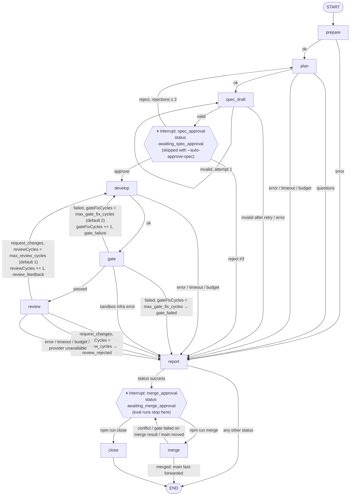

# Workflow graph (Week 2)

Status: **design for approval** (Phase 0). Verified against `@langchain/langgraph` 1.5.0,
`@langchain/langgraph-checkpoint-sqlite` 1.1.0 by a scratch probe (see
`docs/week2-design.md` → "Verified behavior").

## Principles

- **The graph routes, nodes execute.** Every node is a thin adapter that calls existing
  functions (`git/`, `runtimes/`, `agents/`, `quality/`, `eval/`, `report/`) and returns a
  state update. Business logic stays outside `src/workflow/graph.ts`.
- **Limits live in conditional edges.** One pure function `route(state, after)` decides the
  next node or a stop (`timeout`, `budget_exceeded`, `gate_failed`, …). The `report` node
  calls the same function to record the final status — no duplicated rules.
- **Worktree invariant:** after every node that completes, the worktree is clean at
  `state.headCommit`. A node that changes files first runs
  `git reset --hard <headCommit>` + `git clean -fd` (path-guarded to the worktree), then
  works, then commits and returns the new `headCommit`. A crash mid-node is therefore
  replayed from a clean snapshot, never on top of partial changes.
- **Interrupt nodes are pure.** LangGraph re-executes a node from its start on resume, so
  `spec_approval` and `merge_approval` contain only `interrupt()`; the approval row is
  written by the CLI command that resumes the run.

## Graph

**Cycle budgets are separate.** `gateFixCycles` counts developer re-runs after a failed gate
(checks, scope, policies), `reviewCycles` re-runs after reviewer `request_changes`; each is
checked against its own limit on its own edge (`decide()` in `src/workflow/decide.ts`), and
`develop` increments the counter of the reason it was entered for. A rework after review goes
through the gate again; if the gate fails there, the gate budget is spent, not the review
budget. Both counters are graph state, so they are checkpointed and restored on resume. Spec
rejections (`spec_approval → plan`, ≤ 2) are a third, unrelated limit. A run checkpointed with
the legacy shared `max_fix_cycles` budget is never routed into another fix cycle (`error`).

Every edge leaving an agent or gate node is guarded first by the global limits:
`spentUsd ≥ budgetUsd → budget_exceeded`, `now ≥ deadline → timeout`. Eval runs end at
`merge_approval` (a run that reaches it counts as a `success` claim); nothing is ever
merged automatically.

## Nodes

| Node             | Calls (existing code)                                                             | Side effects                                       | Idempotency on replay                                                                                     |
| ---------------- | --------------------------------------------------------------------------------- | -------------------------------------------------- | --------------------------------------------------------------------------------------------------------- |
| `prepare`        | `ensureTargetRepo`, `createWorktree`, `findHiddenArtifacts`, `ensureSandboxImage` | creates worktree + branch                          | reuses the worktree if `state.worktree` exists; worktree path = f(runId)                                  |
| `plan`           | `ClaudeCodeRuntime`/config runtime, `parsePlannerResult`                          | agent call (read-only)                             | re-runs the agent (costs again); no file changes                                                          |
| `spec_draft`     | planner output → `renderOpenSpecChange` → `openspec validate --strict --json`     | writes `openspec/changes/<taskId>/` and commits it | resets to `headCommit` first; deterministic rendering                                                     |
| `spec_approval`  | `interrupt()` only                                                                | none                                               | pure                                                                                                      |
| `develop`        | runtime (developer), `snapshot`                                                   | edits + commit                                     | resets to `headCommit` first → no duplicated changes                                                      |
| `gate`           | `runGate`, `runInSandbox`                                                         | none (read-only mount)                             | re-runs checks                                                                                            |
| `review`         | runtime (reviewer, Claude Code or OpenCode), `parseReviewerResult`                | agent call (read-only)                             | re-runs the agent                                                                                         |
| `report`         | `route()` for the final status, `renderReportMarkdown`, DB writes                 | writes report files + `runs` row                   | overwrite-only                                                                                            |
| `merge_approval` | `interrupt()` only                                                                | none                                               | pure                                                                                                      |
| `merge`          | base check, `runGate`, `git merge --no-ff`, `openspec archive -y --json`          | merge commit on target `main`, archive commit      | skips merge if branch head is already an ancestor of `main`; skips archive if `archive/*-<taskId>` exists |
| `close`          | DB update                                                                         | `runs.status = closed`                             | overwrite-only                                                                                            |

## Specification (Phase 4)

- The Planner returns the spec as JSON (`SpecChangeSchema`, Zod) together with the plan.
  `spec_draft` renders it deterministically into `openspec/changes/<taskId>/` (proposal,
  delta specs, tasks), runs `openspec validate --strict --json` and commits it ("spec
  commit"). If validation fails, the Planner gets its previous JSON plus the validator output
  once (`spec_draft → spec_draft`); a second failure ends the run with `error`.
- `spec_approval`: with `--auto-approve-spec` (always in eval) the approval is recorded as
  `actor: auto`; otherwise the node calls `interrupt()`, the run becomes
  `awaiting_spec_approval` and the process exits (see `runs/<runId>/spec-approval.md`).
  `npm run approve -- <runId> spec` / `npm run reject -- <runId> spec --comment "…"` record the
  decision in `approvals` and resume with it. A reject returns to `plan` with the comment;
  the third reject ends with `needs_clarification`.
- The developer gets the approved spec (read from the spec commit) as the primary source of
  requirements; the reviewer checks the code diff (`specCommit..HEAD`) against the spec and
  the acceptance criteria. The gate's scope check starts at the spec commit and a separate
  policy check fails the gate if any approved spec file changed.
- Eval runs start from the immutable `factory-baseline` tag; interactive runs from `main`.

## Merge (Phase 5)

- After `report`, only a `success` run continues to `merge_approval` (interrupt, status
  `awaiting_merge_approval`, `runs/<runId>/merge-approval.md`); every other status ends the
  run. Eval runs stop here too: nothing is merged automatically in any mode.
- `npm run merge -- <runId>` records the decision and resumes into `merge`:
  1. a temporary worktree `<workdir>/worktrees/merge-<runId>` is created at main's **current**
     head; `git merge --no-ff --no-commit factory/<task>-<run>`; a conflict blocks the merge;
  2. `openspec archive` runs inside that worktree, and the merge and the archive become ONE
     merge commit (message: title, task, report path, `Factory-Run:` / `Factory-Task:`);
  3. the gate (checks + scope incl. `openspec/**`) runs on that merge commit, not the branch;
  4. only if it passes, main fast-forwards to it — and only if main did not move meanwhile.
     A blocked merge (conflict, gate failure, main moved) leaves main untouched and returns to
     `merge_approval` with the reason. A run already on main is detected (idempotent replay).
- `npm run close -- <runId> --comment "…"` ends the run as `closed` without merging.
- The `factory-baseline` tag is never moved by a merge; only
  `npm run baseline:update -- --reason "…"` moves it, recorded in `baselines`.

## Run statuses

`running` → one of: `needs_clarification` · `gate_failed` · `review_rejected` · `timeout` ·
`budget_exceeded` · `error` · `infra_error` (terminal), or `awaiting_spec_approval` →
`awaiting_merge_approval` → `merged` | `closed`. `success` (Week 1) becomes
`awaiting_merge_approval` in interactive and eval runs; eval classifies it as a success claim.

## Checkpoints and resume (Phase 3)

- Checkpointer: `SqliteSaver` from `@langchain/langgraph-checkpoint-sqlite` on the same
  `data/factory.db` (tables `checkpoints`, `writes`), `thread_id = runId`. A checkpoint is
  written after every completed node.
- `npm run resume -- <runId>`: if the checkpoint has no pending nodes the command only prints
  the run's status. Otherwise it takes the run lock (a live process holding it → refused),
  marks steps left `running` by the dead process as `abandoned` (their cost counts as
  unknown), journals a `resume` event and continues with `invoke(null)`. The node that was
  running when the process died starts again from its beginning (verified).
- Idempotency: `develop` first runs `git reset --hard <headCommit>` + `git clean -fd` on the
  worktree; `assertManagedWorktree` refuses any path that is not a git worktree directly under
  `<workdir>/worktrees`. `prepare` reuses an existing worktree on the expected branch. `gate`,
  `review` and `plan` do not change files and simply run again.
- Deadline: time between the last recorded activity and the resume is excluded from the task
  timeout (`resume.payload.pausedMs`); timestamps in reports stay wall-clock.
- Runs created before Phase 3 have no checkpoint and cannot be resumed.

## Provider unavailable: `infra_error` (Phase 7)

- An agent call the model provider refuses — subscription usage limit, rate limit, overload,
  5xx — is an `infra` step error, recognized from the structured fields of Claude Code's
  `result` event (`api_error_status` 429/529/5xx, `api_error`), never from message text. The
  run ends `infra_error`, distinct from `error` (a factory or agent failure).
- Eval: an `infra_error` task is excluded from every metric (counted as `excludedInfra`), the
  pass stops at once (later tasks would fail the same way) and the eval is `interrupted`.
  `npm run eval -- --resume <evalId>` keeps every decided task, re-runs the interrupted and
  pending ones, then adds repeats up to `--repeat N`. A resume is refused if roles, baseline
  commit or task set differ, or if `prompts/`, `factory.config.ts`, `src/agents/` or
  `src/runtimes/` changed since the commit recorded for an earlier pass.
- Not yet covered: OpenCode provider errors (their event shape has not been observed live, so
  they remain `process` errors), and interactive runs (an `infra_error` run is re-run, not resumed).

## GitHub channel (Week 3)

The graph is unchanged. `npm run factory:watch` (`src/github/watch.ts`) is a second channel for
the two interrupts, next to the CLI: a GitHub `/approve`, `/reject`, `/merge` or `/close` from
an allowed user is recorded in `approvals` with `channel = github` and resumes the run exactly
like `npm run approve` / `merge`. Publishing is a side effect of the run's outcome: the spec
comment at `spec_approval`, the PR at `merge_approval`, status labels and comments at the end.
For GitHub projects, `merge` also fetches the target branch from origin before building the
merge result and pushes the gated merge commit (never forced) before moving the local branch.
