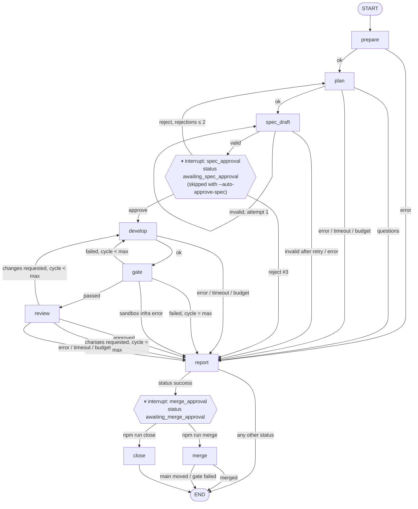

# Workflow graph (Week 2)

Status: **design for approval** (Phase 0). Verified against `@langchain/langgraph` 1.5.0,
`@langchain/langgraph-checkpoint-sqlite` 1.1.0 by a scratch probe (see
`docs/week2-design.md` → "Verified behavior").

## Principles

- **The graph routes, nodes execute.** Every node is a thin adapter that calls existing
  functions (`git/`, `runtimes/`, `agents/`, `quality/`, `eval/`, `report/`) and returns a
  state update. Business logic stays outside `src/workflow/graph.ts`.
- **Limits live in conditional edges.** One pure function `route(state, after)` decides the
  next node or a stop (`timeout`, `budget_exceeded`, `gate_failed`, …). The `report` node
  calls the same function to record the final status — no duplicated rules.
- **Worktree invariant:** after every node that completes, the worktree is clean at
  `state.headCommit`. A node that changes files first runs
  `git reset --hard <headCommit>` + `git clean -fd` (path-guarded to the worktree), then
  works, then commits and returns the new `headCommit`. A crash mid-node is therefore
  replayed from a clean snapshot, never on top of partial changes.
- **Interrupt nodes are pure.** LangGraph re-executes a node from its start on resume, so
  `spec_approval` and `merge_approval` contain only `interrupt()`; the approval row is
  written by the CLI command that resumes the run.

## Graph

Every edge leaving an agent or gate node is guarded first by the global limits:
`spentUsd ≥ budgetUsd → budget_exceeded`, `now ≥ deadline → timeout`. Eval runs end at
`merge_approval` (a run that reaches it counts as a `success` claim); nothing is ever
merged automatically.

## Nodes

| Node             | Calls (existing code)                                                             | Side effects                                       | Idempotency on replay                                                                                     |
| ---------------- | --------------------------------------------------------------------------------- | -------------------------------------------------- | --------------------------------------------------------------------------------------------------------- |
| `prepare`        | `ensureTargetRepo`, `createWorktree`, `findHiddenArtifacts`, `ensureSandboxImage` | creates worktree + branch                          | reuses the worktree if `state.worktree` exists; worktree path = f(runId)                                  |
| `plan`           | `ClaudeCodeRuntime`/config runtime, `parsePlannerResult`                          | agent call (read-only)                             | re-runs the agent (costs again); no file changes                                                          |
| `spec_draft`     | planner output → `renderOpenSpecChange` → `openspec validate --strict --json`     | writes `openspec/changes/<taskId>/` and commits it | resets to `headCommit` first; deterministic rendering                                                     |
| `spec_approval`  | `interrupt()` only                                                                | none                                               | pure                                                                                                      |
| `develop`        | runtime (developer), `snapshot`                                                   | edits + commit                                     | resets to `headCommit` first → no duplicated changes                                                      |
| `gate`           | `runGate`, `runInSandbox`                                                         | none (read-only mount)                             | re-runs checks                                                                                            |
| `review`         | runtime (reviewer, Claude Code or OpenCode), `parseReviewerResult`                | agent call (read-only)                             | re-runs the agent                                                                                         |
| `report`         | `route()` for the final status, `renderReportMarkdown`, DB writes                 | writes report files + `runs` row                   | overwrite-only                                                                                            |
| `merge_approval` | `interrupt()` only                                                                | none                                               | pure                                                                                                      |
| `merge`          | base check, `runGate`, `git merge --no-ff`, `openspec archive -y --json`          | merge commit on target `main`, archive commit      | skips merge if branch head is already an ancestor of `main`; skips archive if `archive/*-<taskId>` exists |
| `close`          | DB update                                                                         | `runs.status = closed`                             | overwrite-only                                                                                            |

## Run statuses

`running` → one of: `needs_clarification` · `gate_failed` · `review_rejected` · `timeout` ·
`budget_exceeded` · `error` (terminal), or `awaiting_spec_approval` →
`awaiting_merge_approval` → `merged` | `closed`. `success` (Week 1) becomes
`awaiting_merge_approval` in interactive and eval runs; eval classifies it as a success claim.
