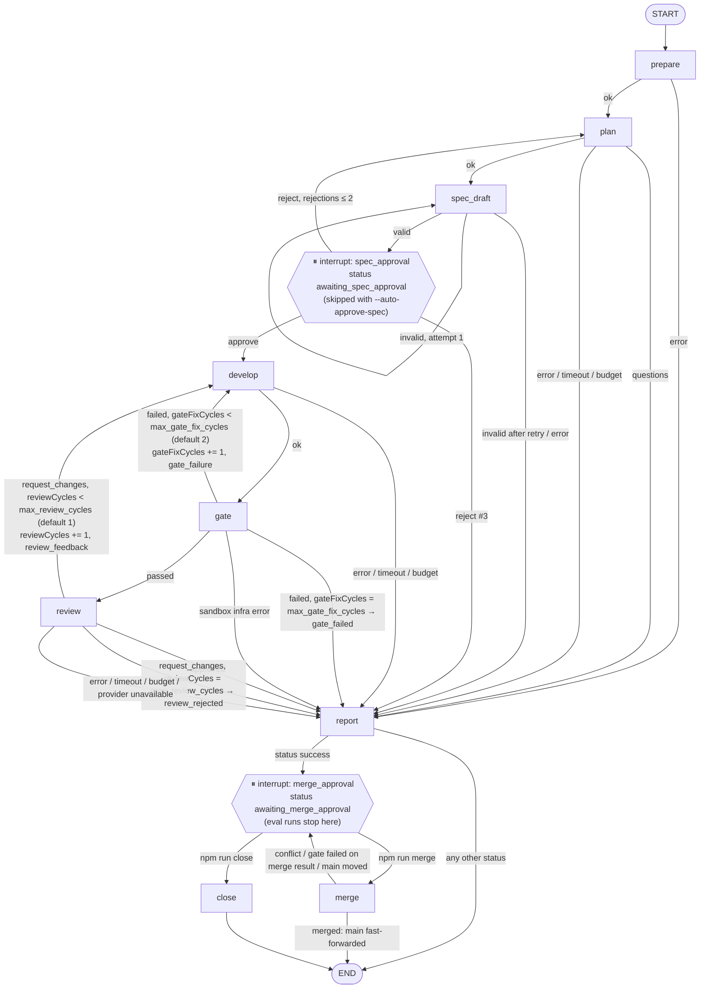

# Start here

**Agentic Software Factory** takes a development task for a target repository and drives it to
a result that is **checked by facts, not by what an agent says**:

1. A planner writes a spec, and a human approves it.
2. A developer agent implements it in an isolated git worktree.
3. The factory's own checks run in a Docker sandbox with no network.
4. A read-only reviewer checks the diff against the spec and the acceptance criteria.
5. A human merges, and the gate runs again on the merge result.

In evals, hidden tests that agents never see decide whether a claimed success is real.

**One factory, many projects** (Week 3):

- The factory names no project in its code. Projects are registered in `projects.yaml`, each
  with its own `.factory/config.yaml`.
- Two stacks today: **TaskFlow** (Fastify + TypeScript, the eval stand) and **ledgerlite**
  (Python 3.12, pytest, mypy, ruff).
- The main interface is **GitHub**: an issue is a task, comments are decisions, and the
  result is a PR. The factory only polls GitHub from the owner's computer.

## Status for review (2026-10-19): Week 3 after Phase 7

Phases 0–7 are implemented, tested and committed. `npm run check` passes: 459 tests on fake
agents, a fake `gh`, the Docker sandbox, and the real Pi binary against a fake provider.

The **final measurement block** (live runs) is in progress:

| #   | Measurement                                                              | Status                                                                                                                                                                                                                                                                                                     |
| --- | ------------------------------------------------------------------------ | ---------------------------------------------------------------------------------------------------------------------------------------------------------------------------------------------------------------------------------------------------------------------------------------------------------- |
| 1   | Equivalence after the Phase 2–7 refactor (Opus in every role)            | **done**: verified 80%, false success 22%, first pass 78% (Week 3 baseline: 67% / 35% / 63%)                                                                                                                                                                                                               |
| 2   | Candidate roles (Sonnet plans and develops, Opus reviews)                | **done**: verified 60%, false success 38%, half the cost                                                                                                                                                                                                                                                   |
| 3   | Live GitHub cycle in two projects                                        | **ledgerlite: merged** (issue → spec → `/approve` → PR #2 → `/merge` → gate on the merge result → `main`). **taskflow-demo:** issue → spec v1 → `/reject` → spec v2 → `/approve` ran live; the developer then hit the task's $1 budget (`budget_exceeded`; the re-plan had used half of it), retry pending |
| 4   | `--concurrency 2`                                                        | **done**: task-for-task the same outcomes as sequential, ~1.6× faster; a subscription limit was hit and resumed                                                                                                                                                                                            |
| 5   | Memory A/B                                                               | **done**: with memory 8/8 runs applied the human decision, without memory 0/16                                                                                                                                                                                                                             |
| 6   | Pi reviewer on a local model                                             | **done**: recall 20% of Opus's (threshold 70%), so no eval with Pi; Opus stays the reviewer                                                                                                                                                                                                                |
| 7–8 | Owner's decisions; final `eval --repeat 3 --concurrency 2`; final report | pending                                                                                                                                                                                                                                                                                                    |

All numbers, with their runs and caveats: [docs/week3-results.md](../week3-results.md). The
plan: [docs/week3-design.md](../week3-design.md) §11. The proposed next weeks:
[docs/roadmap.md](../roadmap.md).

### The week's acceptance criteria

| Criterion                                                                                                                                         | Status                                                                                                                |
| ------------------------------------------------------------------------------------------------------------------------------------------------- | --------------------------------------------------------------------------------------------------------------------- |
| `npm run check` passes                                                                                                                            | ✅ 459 tests                                                                                                          |
| Hidden tests check TaskFlow's rules; `verify-hidden` 10/10; old tests unchanged; baseline by `eval:rescore`                                       | ✅ Phase 1                                                                                                            |
| No TaskFlow in factory code; both projects through the registry and `.factory/config.yaml`; `project:check` passes for both                       | ✅ (live, against the GitHub repositories)                                                                            |
| Full cycle issue → `/approve` → PR → `/merge` on real GitHub in two projects; the Phase 3 fake-`gh` tests pass                                    | ⏳ fake-`gh` tests ✅; live: ledgerlite merged end to end, taskflow-demo stopped at `budget_exceeded` (retry pending) |
| Unauthorized commands ignored, their text never reaches agents; approval bound to a spec version; no command executed twice after a restart       | ✅ tests; live: `/approve` applied to v2                                                                              |
| `--concurrency N` works; the Phase 4 tests pass; live parallel run not worse than the baseline                                                    | ✅                                                                                                                    |
| `PiRuntime` in the chosen role through config; adapter tests pass; eval with Pi run and compared                                                  | ⚠️ Pi works and is tested; the eval was not run by the owner's rule (recall gate failed)                              |
| OpenCode adapter tests pass; `provider:check -- openai` without a key gives a clear message; `docs/enable-openai.md`; OpenAI without code changes | ✅                                                                                                                    |
| Final `eval --repeat 3`; `week3-results.md`, `demo.md`, `new-project.md`, `demo:reset` ready                                                      | ⏳ docs and `demo:reset` ✅; the final eval is pending                                                                |
| Memory isolated per project; forbidden writes tested; A/B done; `memory.enabled` decision recorded with numbers                                   | ✅ A/B done; the decision is the owner's                                                                              |
| Dashboard: runs of all projects, a whole run, evals; no write routes; secrets masked                                                              | ✅                                                                                                                    |

### What the live runs found (and what was fixed)

Fakes passed, and live runs then found five defects in how the factory talks to real tools.
Each is fixed with a regression test:

| Defect                                                                              | Effect                                                      | Fix       |
| ----------------------------------------------------------------------------------- | ----------------------------------------------------------- | --------- |
| Since Phase 4, eval misread runs that ended without the merge gate                  | `needs_clarification` and failures were recorded as `error` | `1122e69` |
| The planner's agent JSON schema had no `lessons` field (Phase 5)                    | Memory could never learn from a rejection                   | `6292a6c` |
| Eval mode forced automatic spec approval over the memory A/B's explicit "manual"    | The first memory A/B ($14.38) measured nothing              | `d5945f2` |
| `project:check` and `run-task --project` cloned GitHub projects with plain git      | git fell back to the owner's macOS keychain                 | `d51bd67` |
| A re-plan after `/reject` within the same second could produce the same spec commit | No spec v2 published (seen as a flaky test)                 | `b2e5595` |

The lesson is the core of Week 4 in the roadmap: contract tests against the real CLIs.

## The loop

A LangGraph state graph, checkpointed in SQLite, so a killed process resumes where it stopped.
Every limit is checked on the conditional edges in one function, `decide()`.



Full description: [docs/graph.md](../graph.md).

## Where to look in the code

| File                                                                                                                              | What it does                                                                                                         |
| --------------------------------------------------------------------------------------------------------------------------------- | -------------------------------------------------------------------------------------------------------------------- |
| [`src/workflow/graph.ts`](../../src/workflow/graph.ts), [`decide.ts`](../../src/workflow/decide.ts)                               | The graph wiring and the single routing rule: cycle budgets, cost, timeout, final status                             |
| [`src/workflow/nodes.ts`](../../src/workflow/nodes.ts)                                                                            | Thin nodes that call existing modules: worktree reset, snapshot, agent steps, report                                 |
| [`src/quality/gate.ts`](../../src/quality/gate.ts), [`sandbox.ts`](../../src/quality/sandbox.ts)                                  | Quality gate: typecheck and tests in Docker (`--network none`), scope and spec-immutability checks                   |
| [`src/runtimes/claude-code.ts`](../../src/runtimes/claude-code.ts), [`provider-errors.ts`](../../src/runtimes/provider-errors.ts) | Claude Code headless adapter (stream-json parsed with Zod; tool policy) and provider-limit detection (`infra_error`) |
| [`src/eval/run-eval.ts`](../../src/eval/run-eval.ts), [`hidden-tests.ts`](../../src/eval/hidden-tests.ts)                         | Eval: hidden tests on a copy of the final worktree; verified, false success and first-pass metrics                   |
| [`src/github/watch.ts`](../../src/github/watch.ts), [`gh-cli.ts`](../../src/github/gh-cli.ts)                                     | GitHub as the interface: polling, commands from allowed users only, exactly-once events, spec versions, PRs          |
| [`src/config/projects.ts`](../../src/config/projects.ts), [`project-check.ts`](../../src/config/project-check.ts)                 | Project registry and per-project `.factory/config.yaml`, read with `git show`; `project:check`                       |
| [`src/pipeline/cost-pool.ts`](../../src/pipeline/cost-pool.ts), [`src/eval/run-eval.ts`](../../src/eval/run-eval.ts)              | Parallel runs: shared cost cap by reservations, pause at node boundaries, `--resume`                                 |
| [`src/memory/`](../../src/memory), [`src/eval/memory-ab.ts`](../../src/eval/memory-ab.ts)                                         | Optional project memory (canonical SQLite + Mem0 index, local Ollama embedder, write guard) and its A/B              |
| [`src/runtimes/pi.ts`](../../src/runtimes/pi.ts), [`pi-guard.ts`](../../src/runtimes/pi-guard.ts)                                 | Pi runtime (read-only roles) and the extension that confines its tools to the worktree                               |
| [`src/dashboard/`](../../src/dashboard)                                                                                           | Read-only dashboard on 127.0.0.1                                                                                     |

## A live run, step by step (Week 2, CLI)

Run `20261016-062925-e708`, task `complete-task` ("POST /tasks/:id/complete; 409 for a deleted
task, 404 for an unknown one"), all roles Claude Code Opus, manual approvals. It cost $0.64.
Files: [report.md](live-run/report.md), [spec-approval.md](live-run/spec-approval.md),
[merge-approval.md](live-run/merge-approval.md), [merge.md](live-run/merge.md), and the
database history (approvals, events, steps) in [db-history.md](live-run/db-history.md).

1. **prepare**: an isolated worktree on branch `factory/complete-task-…`, starting from TaskFlow
   `c3ec3cd`, outside the factory repository.
2. **plan → spec_draft**: the planner (32.5 s, $0.20) returns a plan and an OpenSpec change.
   `openspec validate` passes, and the run stops at **spec approval**.
3. **The human rejects the spec**: the spec added a "strict request body" requirement that is
   not in the acceptance criteria. The rejection comment goes back to the planner (approval #1
   in [db-history.md](live-run/db-history.md)).
4. **plan again → new spec → the human approves** (approval #2,
   [spec-approval.md](live-run/spec-approval.md)).
5. **develop**: the developer (25 s, $0.15) implements the approved spec, and the factory commits
   a snapshot (`18703e7`).
6. **gate**: typecheck and tests run in the sandbox and pass. The developer's own claim that
   "checks pass" is never used as evidence.
7. **review**: the read-only reviewer (12 s, $0.15) checks every acceptance criterion with
   file:line evidence, and all three are met ([report.md](live-run/report.md), "Review").
8. **report → merge approval → merge**: a human runs `npm run merge`. The gate runs again on
   the merge result, and `main` moves with a `--no-ff` commit (`519b82c`) that also archives
   the OpenSpec change ([merge.md](live-run/merge.md)).
9. **Hidden tests**: 3 of 4 fail on the baseline tag, and 4 of 4 pass on the merged `main`
   ([docs/week2-results.md](../week2-results.md), "Resilience (Phase 3–5), verified by tests").

## Metrics

TaskFlow, 10 tasks: 9 are to be implemented, and 1 is contradictory, where the correct answer is
`needs_clarification`.

- **Verified:** the run claimed success _and_ the hidden tests passed.
- **False success:** the run claimed success but the hidden tests failed.
- **First-pass:** verified with no rework.

Week 3's hidden tests also check TaskFlow's own rules, for example "unknown body keys → 400".
That made the suite harder: Week 2's ~97% became 67% on the same diffs.

| Measurement                                                  | Verified     | False success | First-pass   | Cost / pass   |
| ------------------------------------------------------------ | ------------ | ------------- | ------------ | ------------- |
| Week 3 baseline (rescore of the last Week 2 eval, 3 repeats) | 66.7% ± 5.8% | 34.7% ± 2.4%  | 63.0% ± 6.4% | $5.98 ± $0.38 |
| Week 3 code, Opus in every role (1 repeat)                   | 80% (8/10)   | 22% (2/9)     | 78% (7/9)    | $5.86         |
| Same, `--concurrency 2` (1 repeat)                           | 80% (8/10)   | 22% (2/9)     | 78% (7/9)    | $6.52         |
| Sonnet plans and develops, Opus reviews (1 repeat)           | 60% (6/10)   | 38% (3/8)     | 56% (5/9)    | $2.85         |

The remaining false successes are almost all the same rule: a new action endpoint accepts an
unknown body key. The Opus reviewer approves it every time, because it is the same vendor and
model as the developer. This is the main quality limitation. Week 2's numbers:
[docs/week2-results.md](../week2-results.md).

## Honest limitations

- **The reviewer is the same vendor and model as the developer.** The OpenAI reviewer is off by
  the owner's decision, and the local Pi reviewer was too weak (2/10 defects found).
- **Live runs found bugs that fakes hid** (see above). The fakes do not check the contracts of
  the real CLIs yet.
- **The evidence base is small:** 10 tasks on one stand with hidden tests, 1–3 repeats. The
  second project has no hidden tests.
- **The agent runs on the host,** limited by tool allow-lists. Checks run in Docker
  (`--network none`). Pi is additionally confined by the guard extension.
- **It runs on the owner's laptop and subscription.** A session window held about $10 of work;
  the limit was hit 3 times in the final block and recovered every time.
- **No branch protection:** GitHub Free does not offer it for private repositories. The
  factory never force-pushes.

## Try it

```bash
npm ci && npm run check          # typecheck, lint, format, unit tests (fake agents, no network)
npm run verify-hidden            # hidden tests fail on the baseline and pass on the reference patches (Docker)
npm run dashboard                # read-only dashboard on http://127.0.0.1:4317/
npm run demo:reset               # a separate demo sandbox; see docs/demo.md
```

The TaskFlow fixture is part of this repository. On first use, the factory materializes it as a
git repository under `FACTORY_WORKDIR` (default `~/agentic-factory-work`). Running agents
(`npm run run-task`, `npm run eval`) needs an authenticated Claude Code CLI; GitHub needs a
fine-grained token in `.env`; see the [README](../../README.md).
