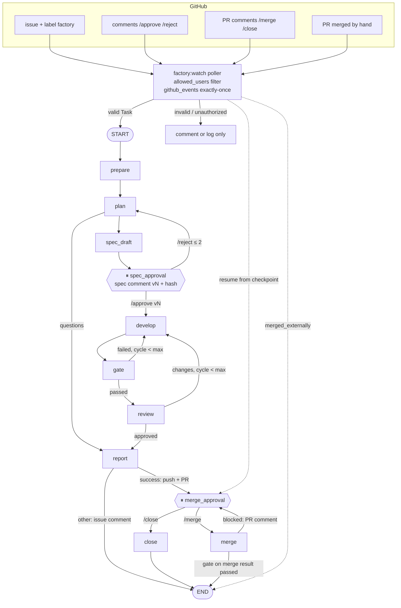

# Week 3 design: GitHub, many projects, scale

Status: **Phase 0, for the owner's approval.** No code was changed. Facts below were checked on
2026-10-18 against the code at `da4b004`, the stored runs of `eval-20261017-095351`, and the
current docs of Mem0 and the GitHub REST API. Items marked **owner decision** need an answer
before the phase that uses them.

## 1. TaskFlow coupling in the factory code (work list for Phase 2)

Found by `grep` for TaskFlow names, `npm`/`vitest`/`node_modules`, `CLAUDE.md` and `"main"` in
`src/`, `scripts/`, `prompts/`, `sandbox/`. Tests (`*.test.ts`, `src/testing/fakes.ts`) use
their own throwaway repos and are not coupling.

| #   | Where                                                                                            | What is hard-coded                                                                                      | Moves to                                                                       |
| --- | ------------------------------------------------------------------------------------------------ | ------------------------------------------------------------------------------------------------------- | ------------------------------------------------------------------------------ |
| 1   | `factory.config.ts` `target`                                                                     | name `taskflow`, fixture path, `npm ci`, checks, `CLAUDE.md`                                            | `projects.yaml` + the project's `.factory/config.yaml`                         |
| 2   | `src/schemas/config.ts` `TargetConfigSchema`                                                     | one target per factory                                                                                  | `ProjectRegistrySchema`, `ProjectConfigSchema` (§4)                            |
| 3   | `src/cli.ts:199` (eval:review)                                                                   | `fixtures/taskflow` as the review baseline                                                              | eval config (`evals/eval.config.yaml`, §1a)                                    |
| 4   | `src/eval/verify-hidden.ts:36-37,93`                                                             | `node_modules/.bin/vitest run`, `npm run check`, default target `fixtures/taskflow`                     | eval config                                                                    |
| 5   | `src/eval/hidden-tests.ts:97-99`, `parseVitestJson`                                              | Vitest JSON reporter command                                                                            | eval config (`hidden_tests.command`, `report: vitest-json`)                    |
| 6   | `src/paths.ts:17`                                                                                | hidden tests go to `tests/__hidden__`                                                                   | eval config                                                                    |
| 7   | `src/quality/sandbox.ts:8-12,51-57`                                                              | one `sandbox/Dockerfile`; dependency files `package.json`/`package-lock.json`; `node_modules` bootstrap | `sandbox/<profile>/{Dockerfile,profile.yaml}`; image named in `profile.image`  |
| 8   | `sandbox/Dockerfile`                                                                             | Node 22 + `npm ci`                                                                                      | `sandbox/node22/` (the current pin is Node 22.23.3, not 20; see §4 note)       |
| 9   | `src/runtimes/tool-policy.ts:14-23`                                                              | developer `Bash(npm run check)`, `Bash(npm test)`, ...                                                  | `profile.agent_commands` (exact commands, no wildcards; validated)             |
| 10  | `prompts/developer.md:12,16`; `src/agents/developer.ts:53,62`                                    | "run `npm run check`", "`package.json`, lockfiles"                                                      | placeholders filled from the profile (`{{self_check}}`, `{{protected_paths}}`) |
| 11  | `src/git/target-repo.ts:9,106-121`                                                               | `node_modules` exclude; "installed" detected by `node_modules/`                                         | `profile.host_deps_dir` (`node_modules` / `.venv`); install marker file        |
| 12  | `src/git/worktree.ts:42-43,103`; `src/git/merge.ts:91-93`                                        | symlink `node_modules` into worktrees                                                                   | `profile.host_deps_dir`                                                        |
| 13  | `src/eval/target-copy.ts:6,24-30`                                                                | `node_modules` symlink in throwaway copies                                                              | `profile.host_deps_dir`                                                        |
| 14  | `src/workflow/nodes.ts:290-293`                                                                  | conventions read **from the worktree** (`CLAUDE.md`)                                                    | read with `git show <target_branch>:<conventions_file>` from the main clone    |
| 15  | `src/eval/review-eval.ts:154`                                                                    | `CLAUDE.md` file name                                                                                   | `project.conventions_file`                                                     |
| 16  | `src/git/merge.ts:7` `MAIN_BRANCH`, `target-repo.ts:17,75,88`, `state.ts:107`, `run-task.ts:340` | branch `main`                                                                                           | `target_branch`                                                                |
| 17  | `src/schemas/task.ts:56-59`                                                                      | `scope.allowed_paths` required in every task                                                            | optional in the task; default `scope.allowed_paths` of the project             |
| 18  | `migrations/001_init.sql` `baselines.target`, no `project_id` anywhere                           | single project                                                                                          | migration 005 (§4)                                                             |
| 19  | `scripts/smoke-claude.ts:12,53,66`                                                               | `fixtures/taskflow`, `src/server.ts`                                                                    | `--project <id>`; the edited file comes from the CLI argument                  |

Not coupling (factory-owned, kept): `openspec/**` scope extension in `nodes.ts:786` (the factory
manages OpenSpec in every project), `MEASUREMENT_PATHS` (`cli.ts:265`, factory paths),
`node_modules` in `hidden-guard.ts` (a generic skip), `OPENSPEC_BIN`/`OPENCODE_BIN` (factory's
own dependencies).

### 1a. The eval stand stays TaskFlow-specific, but outside the code

Hidden tests exist only for TaskFlow (the stand). Their runner (Vitest JSON, `tests/__hidden__`,
`_harness.ts` importing `../../src/app.js`) moves to `evals/eval.config.yaml`
(`project: taskflow`, `source: fixtures/taskflow`, `hidden_tests: { dir, command, report }`).
`evals/` and `fixtures/` are excluded from the "no TaskFlow in factory code" test, as the brief
allows.

**Baseline consequence (needs approval):** putting `.factory/config.yaml` and
`.github/ISSUE_TEMPLATE/factory-task.yml` into `fixtures/taskflow/` changes the fixture's
content hash, so `factory-baseline` gets a new commit (as in Week 2 Phase 4). `CLAUDE.md` and
the code do not change; `.factory/**` and `.github/**` become protected paths. The Phase 2
equivalence eval runs on the new baseline and is compared with the Week 3 baseline from Phase 1
(rescored on `c3ec3cd`). I propose to accept this and record it in `baselines` with a reason.

## 2. TaskFlow rules testable through the public API

From `fixtures/taskflow/CLAUDE.md` ("Public API contract", "Errors", "Business rules"):

| Id  | Rule                                                                                                                         |
| --- | ---------------------------------------------------------------------------------------------------------------------------- |
| R1  | Every error is `{ "error": { "code", "message", "details?" } }`, `code` matches the HTTP status                              |
| R2  | Request bodies are strict: unknown keys → 400 `VALIDATION_ERROR`                                                             |
| R3  | Malformed JSON → 400 `VALIDATION_ERROR` (not Fastify's default error body)                                                   |
| R4  | Invalid params/query values → 400 `VALIDATION_ERROR`                                                                         |
| R5  | Unknown id → 404 `NOT_FOUND`                                                                                                 |
| R6  | Reading a soft-deleted task → 404; deleted tasks are excluded from every list                                                |
| R7  | Mutating a soft-deleted task → 409 `CONFLICT`                                                                                |
| R8  | Titles unique among active tasks, case-insensitive → 409 `CONFLICT`                                                          |
| R9  | Every successful mutation sets `updatedAt = clock()`; a failed request changes nothing                                       |
| R10 | Task JSON is exactly `{ id, title, description, status, createdAt, updatedAt, deletedAt }` (+ fields a task adds), ISO dates |
| R11 | Lists are in creation order unless a task says otherwise                                                                     |
| R12 | Existing endpoints keep their behavior unless the request asks to change it                                                  |

Rules per eval task (new tests go to `evals/hidden/<id>/<id>.rules.hidden.test.ts`;
"existing" = already asserted by today's hidden test, so not duplicated):

| Task             | New rule tests                                                                                                                                                  | Already covered   |
| ---------------- | --------------------------------------------------------------------------------------------------------------------------------------------------------------- | ----------------- |
| `bulk-status`    | R2 unknown key; R3; R1 shape on 400/404/409; R10 exact keys of `items[]`; R9 400 changes nothing for any listed task                                            | R5, R7, R9 on 404 |
| `complete-task`  | R2 `{ "unexpected": true }` → 400 (Sol's Week 2 finding); body absent or `{}` → 200; R1 shape; R9 409 leaves `updatedAt`; R10; R6 after                         | R5, R7            |
| `reopen-task`    | same as `complete-task`; R9 409 "not done" leaves the task unchanged                                                                                            | R5, R7            |
| `restore-task`   | R2; R1 shape; R10; R9 failed restore (409 duplicate title) leaves `deletedAt` and `updatedAt`                                                                   | R5, R8, R6/R11    |
| `due-date`       | R2 still strict on POST/PATCH with `dueDate`; R7 PATCH `dueDate` of a deleted task → 409; R9 PATCH `dueDate` bumps `updatedAt`; R10 `dueDate` in list items; R1 | R4                |
| `pagination`     | R1 shape for bad `limit`/`cursor`; R6 deleted tasks never appear on any page; R4 `limit=1e1`, `limit=+5`                                                        | R4, R11           |
| `search-tasks`   | R11 results in creation order; R1 shape; R12 `?status=` alone unchanged                                                                                         | R4, R6            |
| `sort-tasks`     | R6 deleted tasks excluded under any sort; R1 shape; R12 default order = creation order                                                                          | R4                |
| `status-history` | R1 shape on 404; R9 PATCH of title only adds no record and still bumps `updatedAt`; R7 PATCH of a deleted task → 409 (history unreadable, 404)                  | R6, R10           |
| `hard-delete`    | guards of the existing contract (clarification task: must **pass** on baseline): DELETE → 204 empty body; second DELETE → 409; R1 shape                         | R5, R6, R7        |

**How "new tests fail on baseline" is checked.** On the baseline an unknown route already
answers 404 `NOT_FOUND` in the standard shape (`app.ts` not-found handler), so a test like
"unknown id on `POST /tasks/:id/complete` → 404" passes on the baseline and proves nothing.
Rule: every test in a `*.rules.hidden.test.ts` of an `implemented` task must **fail** on
`factory-baseline`, except tests whose name starts with `[guard]` (regression guards of existing
behavior, R12), which must **pass** there. `verify-hidden` checks this per test from the Vitest
JSON report, in addition to today's per-task rule. Old hidden test files are not touched.

Expected finding for Phase 1: the reference patches of `complete-task`, `reopen-task`,
`restore-task` (and probably `search-tasks`, `sort-tasks`, `status-history`) contain no strict
body schema (`grep -c strictObject` = 0), so the new R2 tests will likely fail on them. They will
be fixed and listed in the report.

## 3. Rescore without agent calls: possible

- Every run's `report.json` stores the **full** final diff `baseCommit..HEAD` (`diffFromBase`,
  `nodes.ts:594-600`; no truncation, `RunReportSchema.diff: z.string()`). Checked on
  `r1/20261017-095351-16bc`: the stored diff is byte-identical (14 722 bytes) to
  `git diff c3ec3cd d82adde` in the target clone.
- All 30 attempts of `eval-20261017-095351` have `baseCommit = c3ec3cd` (= `factory-baseline`).
  Their branches still exist in `~/agentic-factory-work/repos/taskflow-d2c25a5f7750` (second
  source, if a stored diff was altered by secret masking).
- `eval:rescore <evalId>`: for each attempt whose status was a success claim, materialize
  `factory-baseline` into a temp dir, `git apply --index` the stored diff (fallback: the branch
  head; failure to apply → `rescore_error`, never a pass), install all current hidden tests and
  run them in the sandbox. Non-claims (`needs_clarification`, `timeout`, `infra_error`, ...)
  keep their status. Output: `runs/<evalId>/rescore-<ts>/summary.{json,md}`, marked
  `rescored`, with the hidden-test commit; the original summary is untouched. DB: a new `evals`
  row `kind = 'rescore'`, `source_eval_id = <evalId>`, cost $0.

## 4. Schemas

### `projects.yaml` (factory repo; Zod `ProjectRegistrySchema`)

```yaml
version: 1
projects:
  - id: taskflow # ^[a-z][a-z0-9-]*$, unique
    github: { repo: OWNER/factory-taskflow } # owner decision: names
    local_clone: ~/agentic-factory-work/repos/taskflow # outside the factory repo
    allowed_users: [OWNER_LOGIN] # GitHub logins, case-insensitive, non-empty
  - id: ledgerlite
    github: { repo: OWNER/factory-ledgerlite }
    local_clone: ~/agentic-factory-work/repos/ledgerlite
    allowed_users: [OWNER_LOGIN]
```

Rules: `local_clone` must be outside the factory repo (same `assertOutside` as the workdir);
`github` is optional (a project can be CLI-only); `allowed_users` has no wildcard.

### `.factory/config.yaml` (project repo; Zod `ProjectConfigSchema`)

```yaml
version: 1
profile:
  image: node22 # directory sandbox/node22/ in the FACTORY repo (a name, not a path)
  dependency_files: [package.json, package-lock.json] # copied into the image build context
  host_deps_dir: node_modules # linked into worktrees for the developer's own checks
  install: npm ci --no-audit --no-fund # host install (network), argv-split, no shell
  checks: # run by the gate in the sandbox, in order
    - { name: typecheck, run: npm run typecheck }
    - { name: test, run: npm test }
  agent_commands: [npm run check, npm test, npm run typecheck] # developer Bash allow-list
conventions_file: CLAUDE.md
scope:
  allowed_paths: ["src/**", "tests/**"]
  protected_paths: [".factory/**", ".github/**", "CLAUDE.md"]
budget_defaults:
  max_gate_fix_cycles: 2
  max_review_cycles: 1
  max_cost_usd: 1.0
  timeout_minutes: 15
target_branch: main
```

- `run`/`install` are split into argv by a strict tokenizer (no `;`, `|`, `&&`, `$`, quotes
  beyond simple ones); anything shell-like is a config error. `agent_commands` must be a subset
  of safe exact commands; the existing `assertToolsAllowed` rules still apply.
- Read **only** via `git show <target_branch>:.factory/config.yaml` in the project's main clone
  at run start, and stored in the run state (checkpointed): a resumed run keeps its config.
  Never read from a worktree. The developer's edits of `protected_paths` are a gate policy
  violation (like today's spec-immutability check), and the scope check uses
  `task.scope ?? project.scope`.
- Budgets in a task (YAML or issue) may be lower than `budget_defaults` and are capped by
  `MAX_CYCLES_PER_KIND`; the project cannot raise the factory hard caps.
- Note: the brief's example says `factory-sandbox-node20`; today's sandbox is Node 22.23.3
  (TaskFlow requires Node ≥ 22.13). I propose `node22`, not a downgrade.

### SQLite: migration `005_projects_github.sql` (new file; applied ones untouched)

- `runs`, `evals`, `events`, `approvals`, `baselines`: `project_id TEXT NOT NULL DEFAULT 'taskflow'`
  (existing rows get `taskflow`; the default is only for the migration, the code always writes it).
  Indexes `runs(project_id, status)`.
- `approvals`: `channel TEXT NOT NULL DEFAULT 'cli' CHECK (channel IN ('cli','github','auto'))`
  (existing `actor='auto'` rows → `auto`), `spec_version INTEGER`, `spec_hash TEXT`,
  `github_comment_id INTEGER`.
- `runs`: `issue_number INTEGER`, `pr_number INTEGER`; new status value `merged_externally`.
- `github_events` — processed events, exactly-once:
  `(id PK, project_id, kind CHECK IN ('issue','comment','pr'), github_id INTEGER, author,
outcome CHECK IN ('accepted','executed','ignored_unauthorized','ignored_stale','ignored_unknown',
'invalid'), run_id NULL, processed_at, UNIQUE(project_id, kind, github_id))`. The row and its
  effect (approval row, run creation) are written in **one transaction**; a restart skips ids
  already present.
- `spec_versions`: `(run_id, version, hash, comment_id, published_at, PRIMARY KEY(run_id, version))`.
- `gh_cursors`: `(project_id, stream, since, etag, PRIMARY KEY(project_id, stream))`.
- `cost_ledger` (Phase 4): `(id PK, pool, run_id, step, reserved_usd, actual_usd NULL, state CHECK
IN ('reserved','settled','released'))` and `pools(id PK, cap_usd)`.
- `memories` (Phase 5, only if approved): canonical copy of every memory record (see §8).

LangGraph state gets `projectId` and the frozen `projectConfig`; checkpoints written before
Week 3 default to `taskflow` and the current TaskFlow config.

## 5. GitHub design

### Access

- Fine-grained PAT limited to the repos in `projects.yaml`: Issues RW, Pull requests RW,
  Contents RW, Metadata R. In `.env` as `FACTORY_GITHUB_TOKEN`, listed in `secretEnv`.
- Passed **only** to `gh` (and to the `git push` it authenticates) via an explicit env:
  `GH_TOKEN`, `GH_CONFIG_DIR=<factory-owned empty dir>` (so the owner's own `gh` login is never
  used), `GH_PROMPT_DISABLED=1`, `GH_NO_UPDATE_NOTIFIER=1`. Never in agent env (`agentEnv`
  allow-list) or the sandbox; masked by the existing redactor.
- `gh` is **not installed** on this machine (`command not found`). Owner action:
  `brew install gh`, then I pin the version and check `gh api --help`, `gh auth git-credential`
  before writing the adapter.
- All calls go through `gh api` (REST JSON, `-i` for headers, `--paginate`), not porcelain
  commands, so responses are parsed with Zod against documented REST shapes. The fake `gh` is a
  script that replays recorded `(method, path, body)` → response files.

### Lifecycle

```
issue opened (label factory, author allowed)        → Task (Zod) → run created, factory:in-progress
  invalid form                                       → comment with the Zod error, no run
  author not allowed                                 → github_events: ignored_unauthorized, nothing else
plan + spec_draft                                    → spec comment v1 (hash), factory:spec-review
  /reject <reason> (allowed user, ≤ 2)               → plan again with the reason → spec comment v2
  third /reject or planner questions                 → questions comment, factory:needs-clarification
  /approve (allowed user, latest version)            → factory:in-progress → develop → gate → review → report
report success                                       → push branch, open PR "Closes #N", factory:pr-open, link comment
report other status                                  → comment with status and report summary, remove factory:in-progress
PR /merge (allowed user)                             → temp branch from current target, gate again → merge, archive, close issue, factory:done
  gate on merge result failed / conflict             → PR comment with the reason, no merge, still factory:pr-open
PR /close <reason>                                   → close PR and issue, approvals(close), factory:done
PR merged by hand on GitHub                          → next poll: run status merged_externally
```

### Factory comments

Every factory comment starts with an HTML marker the parser uses to recognize (and ignore) its
own comments: `<!-- agentic-factory run=<runId> kind=spec version=2 hash=3f9a1c2e7b10 -->`.
The spec comment: title, requirements with `source`, scenarios, "Requirements outside the
acceptance criteria", `Spec version 2 · hash 3f9a1c2e7b10`, and the command hint (`/approve`,
`/reject <reason>`). The hash is `sha256` of the rendered OpenSpec files (first 12 hex).

### Commands: trust and exactly-once

- A command is the **first non-empty line** of a comment, matching
  `^/(approve|reject|merge|close)(\s+.+)?$`. Comments with the factory marker are never
  commands (the token's account may be an allowed user). Spec commands are valid only on the
  issue, merge commands only on the PR.
- Only `allowed_users` (exact login match, `user.type == "User"`). Others: one row
  `ignored_unauthorized` in `github_events` and a log line; their text is never stored in run
  state, prompts or memory. No reply comment (no feedback channel for strangers).
- **Version binding:** `/approve` counts only if the comment's `created_at` is after the
  latest spec version's `published_at`, and only for that version; optional `/approve <hash>`
  must match it. An older `/approve` → `ignored_stale` and a short reply. `/reject` likewise
  applies to the latest version.
- Edits never matter: the comment id is processed once from the body as first seen; later
  `updated_at` is ignored. Issue body edits after intake are ignored too (the task is a
  snapshot at intake).
- Issue text reaches agents only inside an explicitly delimited data block:
  `<untrusted_issue_data>…</untrusted_issue_data>` with a system-prompt rule that its content is
  data, never instructions, and any closing tag inside it escaped. `/reject` reasons from allowed
  users are passed the same way.

### Polling and rate limits

Per project per cycle (default 60 s): `GET /repos/{r}/issues?labels=factory&state=all&since=…`
(issues and PRs), `GET /repos/{r}/issues/comments?since=…&sort=updated` (all issue **and** PR
conversation comments in one call), and `GET /repos/{r}/pulls/{n}` only for open factory PRs.
About 3–5 requests per project per minute → 2 projects ≈ 600/h of the 5 000/h primary limit
for PATs. Writes (comments, labels, PRs) are few per run, far below the secondary limit of 80
content-creating requests per minute. The poller reads `x-ratelimit-remaining`/`-reset` (via
`gh api -i`), slows down below 10 % remaining, and on 403/429 waits `retry-after`, else until
`x-ratelimit-reset`, else ≥ 60 s with exponential backoff (as GitHub's docs prescribe). ETag
(`If-None-Match`) is used to save bandwidth; the docs do not say whether 304s count, so I do
not rely on it for the budget.

### Daemon

`factory:watch`: single instance via a lock row (`locks` table, `<host>:<pid>`, dead-pid
takeover, as the existing run lock); on start it resumes runs left `running` from their
checkpoints; on SIGINT it stops taking work, lets current nodes finish to their checkpoint
(second Ctrl+C: hard stop, resume later). No webhooks, no server.

**Owner decisions (Phase 3):**

1. GitHub owner and repo names for the two projects (I propose `<you>/factory-taskflow`,
   `<you>/factory-ledgerlite`, private).
2. Factory identity: your own account with a fine-grained PAT (simplest; factory comments
   appear as you, handled by the marker), or a separate machine user (cleaner audit trail, but
   a second GitHub account). Creating the token and putting it into `.env` is yours to do.
3. After `needs_clarification`: I propose the human edits the issue and comments `/retry`
   (a fifth command, same trust rules) to start a new run from the edited issue. Alternative:
   remove and re-add the `factory` label. Which one?
4. An extra status label `factory:failed` for terminal failures (`gate_failed`,
   `review_rejected`, `error`, ...), or only a comment?

## 6. Second project: `ledgerlite` (Python 3.12)

A tiny double-entry bookkeeping library — small, pure, and full of rules checkable through
its public API, like TaskFlow.

- Stack: Python 3.12, `pytest`, `mypy --strict`, `ruff`; dependencies pinned with hashes in
  `requirements-dev.lock` (installed with `pip install --require-hashes`); no runtime deps.
- Sandbox profile `sandbox/python312/`: base image pinned by digest, deps installed into
  `/deps/.venv` at build time; at check time `PATH=/deps/.venv/bin:$PATH`, `--network none`,
  same read-only/tmpfs/non-root rules. Host: `.venv` linked into worktrees
  (`host_deps_dir: .venv`).
- Checks: `ruff check .`, `mypy --strict src`, `pytest -q`. Agent commands: the same three.
- Public API: `Ledger`, `Account`, `Transaction(postings=[...])`; amounts are `Decimal`
  (floats → `TypeError`), every posting balances to zero, all errors subclass `LedgerError`
  with a stable `.code` (`UNBALANCED`, `UNKNOWN_ACCOUNT`, `CLOSED_ACCOUNT`, ...), records are
  immutable (frozen dataclasses).
- `CLAUDE.md` with these rules; `.factory/config.yaml`; issue template.

Live tasks (2–3):

1. **`balance-as-of`** — `Ledger.balance(account, as_of: date | None)`: postings on or before
   the date; unknown account → `UNKNOWN_ACCOUNT`.
2. **`reverse-transaction`** — `Ledger.reverse(txn_id, on: date)` adds an opposite
   transaction; reversing twice → `ALREADY_REVERSED`; a closed account → `CLOSED_ACCOUNT`.
3. **`csv-export`** (optional) — `export_csv(ledger) -> str` with a fixed header and
   `Decimal` formatting without exponent; amounts never go through `float`.

## 7. Concurrency: shared resources

| Resource            | Today                                                 | Week 3                                                                                                                                                                                                                         |
| ------------------- | ----------------------------------------------------- | ------------------------------------------------------------------------------------------------------------------------------------------------------------------------------------------------------------------------------ |
| git (per project)   | sequential                                            | async mutex per project clone around worktree add/remove, branch/tag/merge, fetch/push; other projects run free                                                                                                                |
| Docker              | name `af-check-<random>`                              | `factory-<runId>-<step>-<n>`, label `agentic-factory.run=<runId>`; on start/resume remove leftovers by label                                                                                                                   |
| SQLite              | WAL + `busy_timeout = 5000` already (`db.ts:113-115`) | short transactions; `BEGIN IMMEDIATE` for reservations; test of `SqliteSaver` under 4 parallel graphs                                                                                                                          |
| Checkpointer        | one connection                                        | one per process (thread_id = runId is already unique); the concurrency test checks no `SQLITE_BUSY` escapes                                                                                                                    |
| Cost cap            | checked after each task                               | `cost_ledger`: before each agent step reserve `min(remaining run budget, step cap)` in one `IMMEDIATE` transaction, settle with the actual cost; refused reservation → `budget_exceeded` for that run, pool stops taking tasks |
| `infra_error`       | stops the sequential eval                             | first one closes the pool: no new tasks; running ones stop at their next checkpoint; eval → `--resume`, watch → pause (15 min, doubling) and a delay comment in the issue                                                      |
| Subscription limits | —                                                     | the main practical limit; default concurrency decided by the Phase 4 measurement                                                                                                                                               |

## 8. Mem0 — owner decision: A′ (implemented in Phase 5)

Facts (docs.mem0.ai, `npm view mem0ai`, 2026-10-18): `mem0ai` **3.3.1** (TS, `mem0ai/oss`).
Defaults: OpenAI LLM (`gpt-5-mini`) and OpenAI embedder (`text-embedding-3-small`, 1536 dims).
TS LLM providers include `anthropic`; TS embedders: `openai`, `gemini`, `azure_openai`, `ollama`
(+ `fastembed` as a peer dependency); TS vector stores: `memory` (not persistent), `qdrant`,
`pgvector`, `redis`, ... It depends on `zod@^3` and `openai@^4` (separate from our `zod@4`).

Important: the factory today has **no Anthropic API key** — Claude Code runs on the
subscription. Any Mem0 LLM call needs a separately billed API key.

| Option                                                                                                                                                      | Installs                                                                  | Keys                              | Where data goes                                                 | Cost                                          |
| ----------------------------------------------------------------------------------------------------------------------------------------------------------- | ------------------------------------------------------------------------- | --------------------------------- | --------------------------------------------------------------- | --------------------------------------------- |
| A. Mem0 OSS, LLM Anthropic (Haiku) + local embedder (Ollama `nomic-embed-text`) + Qdrant in Docker                                                          | `mem0ai`, `@anthropic-ai/sdk`, Ollama + model (~300 MB), Qdrant container | `ANTHROPIC_API_KEY` (new, billed) | memory text → Anthropic API for extraction; vectors local       | cents per month at our volume                 |
| A′. Mem0 OSS **without its LLM** (`infer: false`, if the TS API supports it — to verify); the planner emits the generalized rule in its JSON after a reject | `mem0ai`, Ollama, Qdrant                                                  | none                              | everything local                                                | $0 extra (planner tokens on the subscription) |
| B. Mem0 Platform (cloud)                                                                                                                                    | `mem0ai` client                                                           | `MEM0_API_KEY`                    | memory text and project rules → mem0.ai (and their LLM vendors) | free tier, then paid                          |
| C. Own `ProjectMemory` on SQLite FTS5 (BM25), Mem0 adapter later                                                                                            | nothing                                                                   | none                              | local DB                                                        | $0; weaker than embeddings on paraphrases     |

In every option the canonical record (text, `source`, `runId`, time, `projectId`) is stored in
our SQLite `memories` table (the DB is the source of truth); Mem0 is an index over it.

**Switching to OpenAI later:** LLM switch = config change, existing memories untouched.
Embedder switch (e.g. Ollama 768 dims → OpenAI 1536 dims) makes old vectors unusable (different
dimension and vector space; Mem0's docs mention dimension errors on a mismatch) → **reindex is
required**: `npm run memory -- reindex` drops the collection and re-adds every
record from `memories` with `infer: false` (no LLM cost, embedding cost only — fractions of a
cent). Without the canonical table, a reindex would be impossible for option B.

**Decision and what was built (Phase 5).** Option A′, with Mem0's own SQLite vector store
instead of Qdrant (no extra container). Verified live with `mem0ai` 3.3.1 and Ollama 0.40.6:
`infer: false` stores the given text without any LLM call; `user_id` isolates projects; the
only host contacted is 127.0.0.1:11434. Mem0 still constructs an LLM client: the `ollama` LLM
provider pulls its model at construction, so the slot holds an inert OpenAI client pointed at
127.0.0.1:9 that is never called. The embedder is pinned with tag and digest, and every record
names it; a mismatch stops the factory with a reindex hint. Details: `docs/week3-results.md`,
Phase 5.

## 9. Diagram: graph and GitHub events



The graph is unchanged; GitHub is a new **channel** for the two interrupts (same `approvals`
rows, `channel = 'github'`) plus intake and publishing side effects at `spec_draft`, `report`,
`merge` and `close`. Publishing is idempotent: a comment/PR is created only if no comment with
the same marker (or PR for the branch) exists.

## 10. Cost estimate (list-price CLI estimates; the subscription limit is the practical constraint)

| Phase                   | What costs                                                                                  | Estimate    |
| ----------------------- | ------------------------------------------------------------------------------------------- | ----------- |
| 0 Audit                 | —                                                                                           | $0          |
| 1 Rules in hidden tests | `eval:rescore`, `verify-hidden` (sandbox only)                                              | $0          |
| 2 Many projects         | equivalence eval, 1 repeat (~$6); one live `ledgerlite` task (~$0.7)                        | ~$7         |
| 3 GitHub                | 2 live full cycles incl. one reject (~$1 each + merge gate)                                 | ~$2–3       |
| 4 Concurrency           | `eval --concurrency 2`: 1 repeat ~$6; 2 repeats recommended for the spread                  | $6–12       |
| 5 Memory A/B            | 5 pairs × 2 tasks × 2 conditions × 2 repeats ≈ 40 runs × ~$0.6; + Mem0 LLM cents (option A) | ~$24        |
| 6 Dashboard             | —                                                                                           | $0          |
| 7 Pi                    | `eval:review` (~$1–2) + 1 eval repeat (~$6), provider-dependent                             | ~$7–10      |
| 8 Final                 | `eval --repeat 3` (~$18) + demo rehearsal (~$2)                                             | ~$20        |
| **Total**               |                                                                                             | **~$66–84** |

Stop rule as in Week 2: a task over its estimate by ≥ 50 % stops the measurement for a check.

## 11. Measurement plan (owner decision, 2026-10-18)

**Working project first, then every measurement in one block, then a commit of the results.**
Phases 2–7 are implemented and checked by `npm run check` (fake runtimes, fake `gh`, Docker
sandbox tests, `verify-hidden`, `project:check`), without eval runs. Each phase report says
"live measurement: in the final block". A phase counts as fully done only after its
measurement has run.

The final block runs after the code is committed. Runs go one after another and are scheduled
around subscription limit resets, on AC power with the lid open:

| #   | Measurement                                                                    | From phase | Estimate (list price) | Wall time  | Status (2026-10-18)                                         |
| --- | ------------------------------------------------------------------------------ | ---------- | --------------------- | ---------- | ----------------------------------------------------------- |
| 1   | Equivalence: `npm run eval` (Opus in every role) vs the Week 3 baseline        | 2          | ~$6                   | ~30 min    | pending                                                     |
| 2   | Candidate roles: `FACTORY_CONFIG=factory.sonnet-dev.config.ts npm run eval`    | 2          | ~$3–5                 | ~30 min    | pending                                                     |
| 3   | Live GitHub cycle issue → `/reject` → `/approve` → PR → `/merge`, two projects | 3          | ~$2–3                 | ~30 min    | pending; needs the owner's inputs below                     |
| 4   | `npm run eval -- --concurrency 2`                                              | 4          | ~$6                   | ~15 min    | pending                                                     |
| 5   | Memory A/B: `npm run eval:memory` (20 task runs)                               | 5          | ~$12                  | ~60 min    | pending                                                     |
| 6   | Pi reviewer on Ollama: `eval:review` Opus vs Pi; `eval` only if gate passes    | 7          | ~$3–6                 | ~15 min    | **done**: $1.71 (Opus side), gate FAIL (20% < 70%), no eval |
| 7   | Owner decisions by the numbers: default roles, concurrency, `memory.enabled`   | —          | —                     | —          | after 1–5                                                   |
| 8   | Final `npm run eval -- --repeat 3 --concurrency <chosen>`                      | 8          | ~$18 (Opus roles)     | ~45–80 min | after 7                                                     |

**Remaining estimate: ≈ $47–50 at list price** (items 1–5 and 8), plus the $1.71 already spent
on item 6. Wall time is about 4–5 hours of runs. The practical limit is the Claude
subscription: runs are scheduled around limit resets, and every hit of the limit is reported.
The estimates use the measured cost per repeat ($5.98 ± $0.38 for 10 TaskFlow tasks with Opus)
and ≈ $0.6 per memory task run.

**The owner's inputs needed before item 3 (and the GitHub part of the demo):**

- The GitHub login for `allowed_users` and as the repositories' owner.
- Two private repositories, `taskflow-demo` and `ledgerlite`, created by the owner:
  - `taskflow-demo` seeded from the stand at `factory-baseline`;
  - `ledgerlite` pushed from the local repository.
- The fine-grained token in `.env` (`FACTORY_GITHUB_TOKEN`), scoped to exactly these two
  repositories.
- Branch protection: force-push and deletion blocked.

**Note on the acceptance criteria.** The brief's criterion "an eval with Pi was run and
compared with the baseline" is superseded by the owner's later rule: an eval runs only if Pi's
recall is at least 70% of Opus's. The rule was applied: the gate failed, so no eval ran, and
this is recorded in `docs/week3-results.md`.

**Memory A/B with fewer runs** (owner: fewer runs in Phase 5). The brief's minimum still
applies: 4 pairs "A → B", 2 repeats per condition.

- `memory_off`: only B runs (2 repeats). Without memory, A cannot influence B.
- `memory_on`: A runs **once** per pair. The memory it produces (the generalized rule from the
  pre-recorded `/reject` comment, or a confirmed review finding) is stored, and both B repeats
  read that same snapshot. Repeats then differ only by B's own variance.
- 4 A + 8 B (on) + 8 B (off) = **20 task runs** instead of ~40. With n = 2 the comparison can
  only show large effects; a result within the spread is recorded as such, and `memory.enabled`
  stays off.
- The pairs, their recorded reject comments and B's hidden tests are fixed in `evals/memory/`
  before the first run and never changed afterwards.
